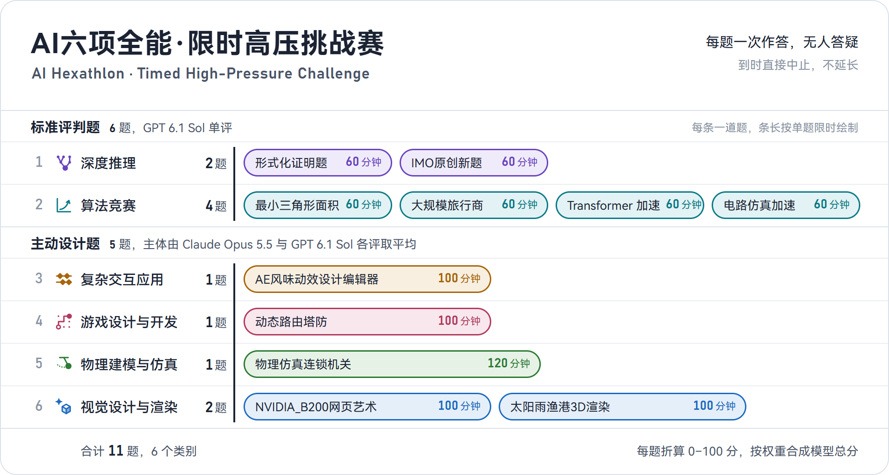
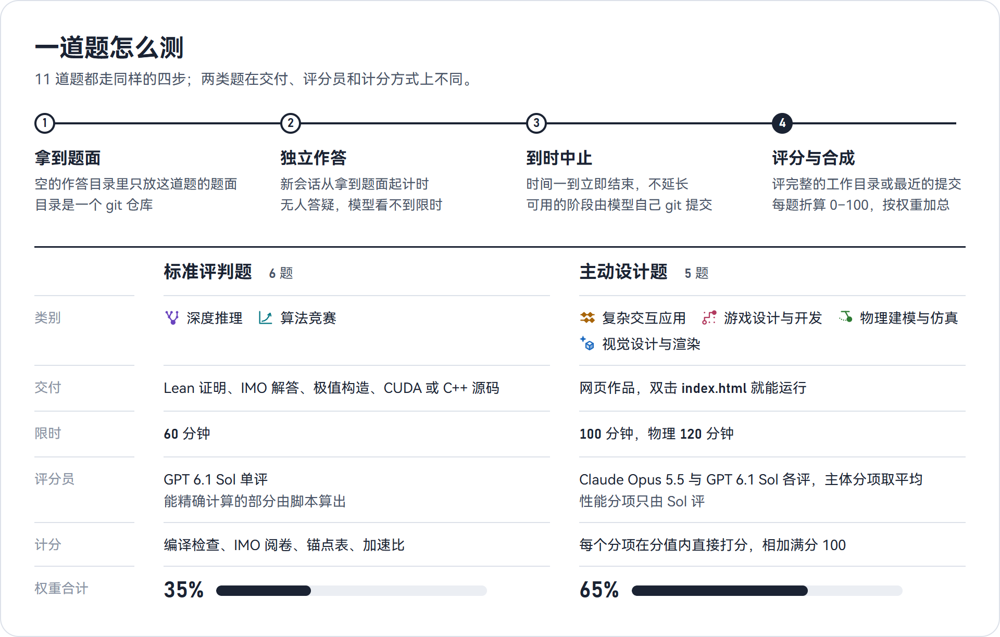
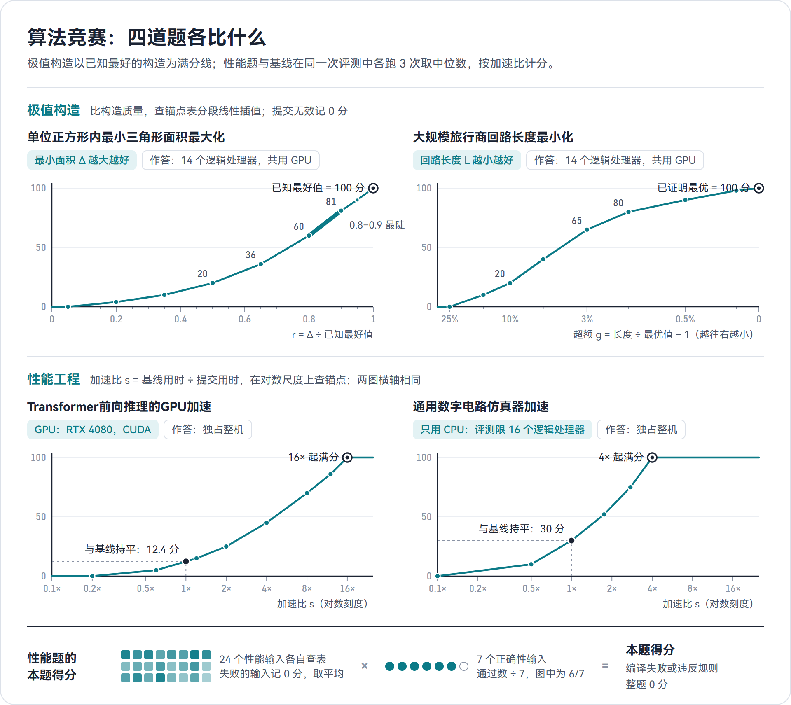
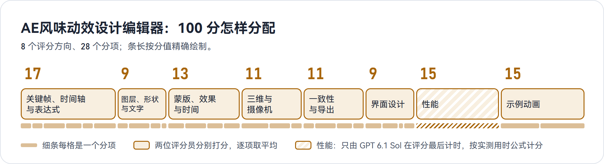
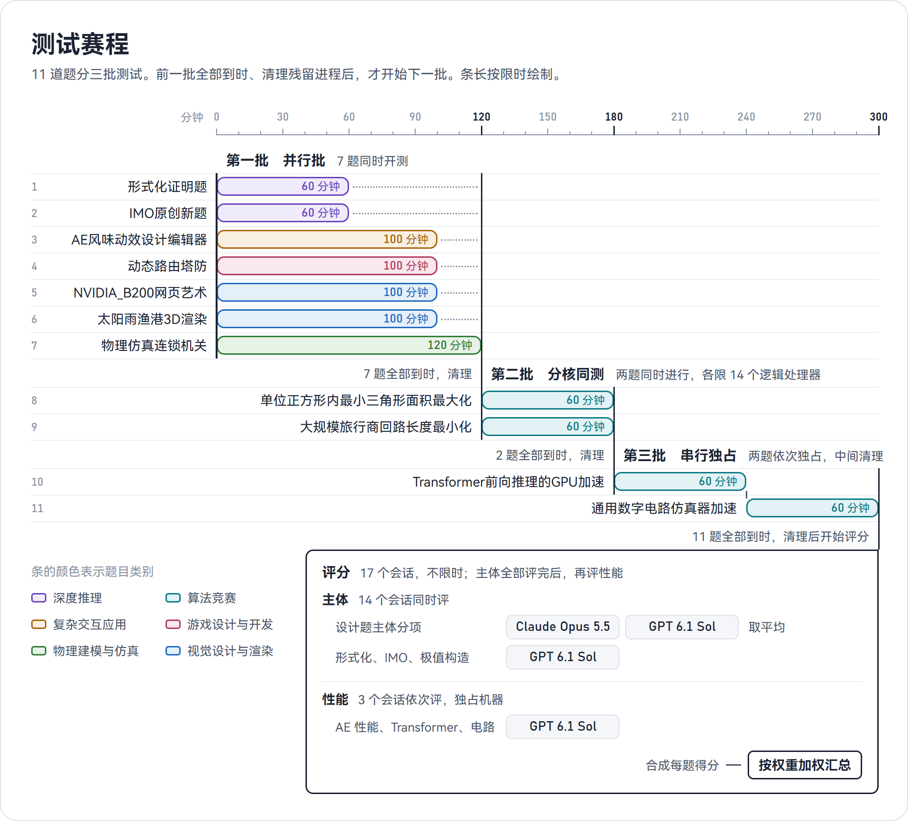
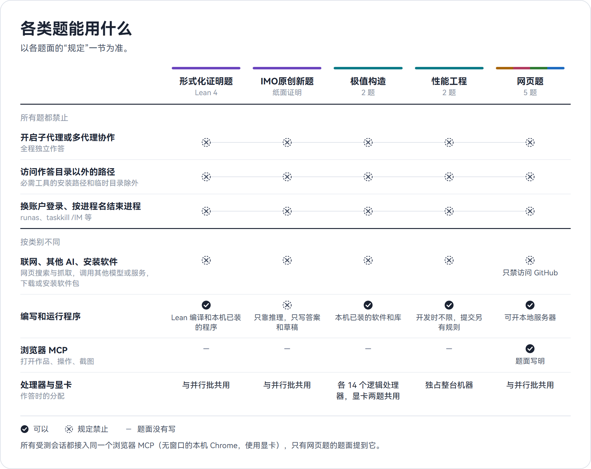
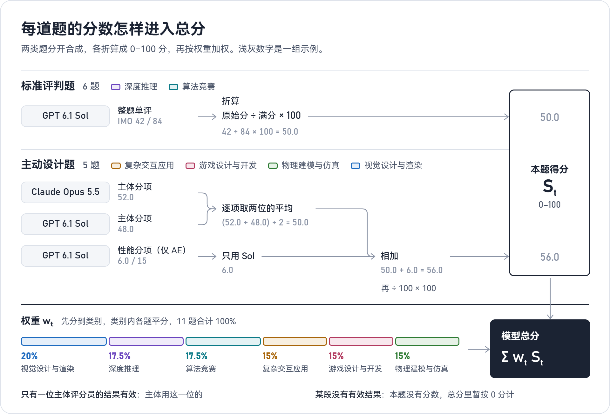
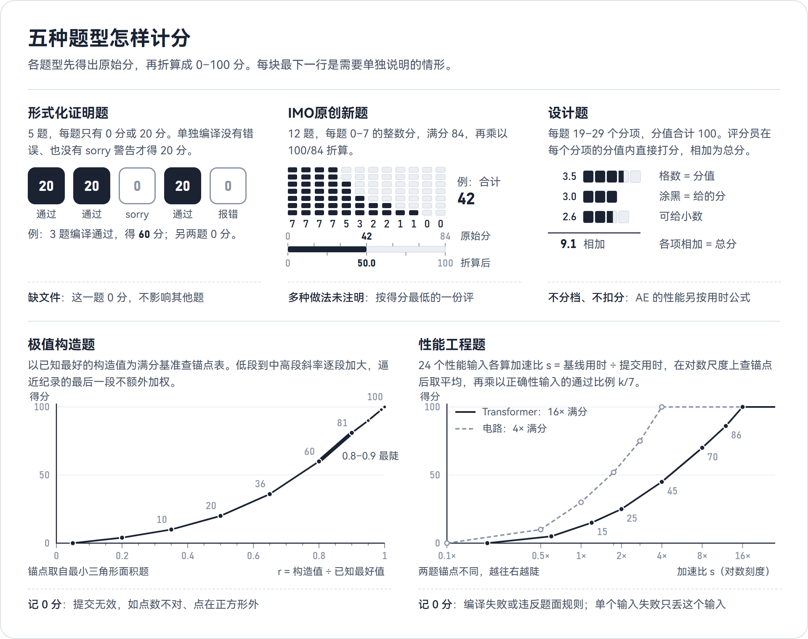
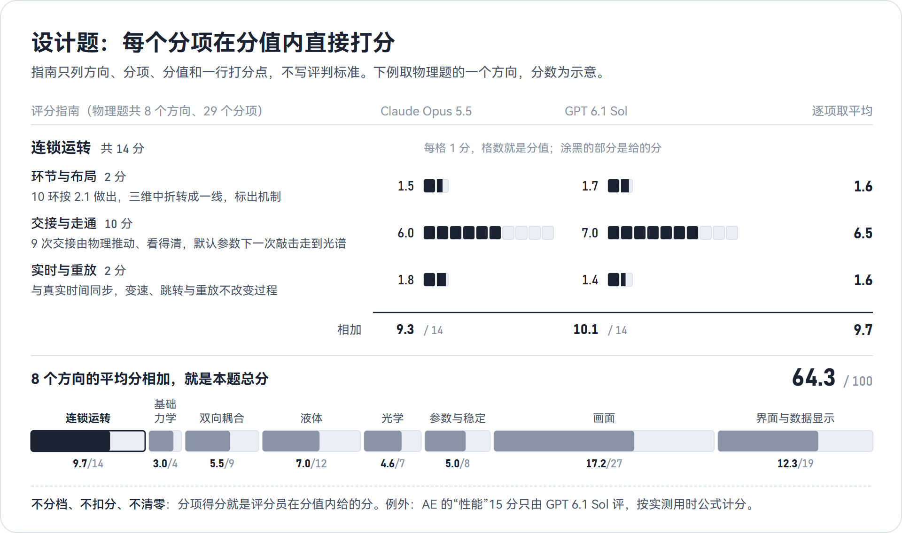

<p align="center"></p>

<p align="center">11 道题、6 个类别：AI 编程智能体每题只有一次机会，在 60–120 分钟内独立作答，到时直接中止。</p>

---

## 目录

- [项目简介](#项目简介)
- [题目总览](#题目总览)
- [题目与考点](#题目与考点)
- [测试形式](#测试形式)
- [打分机制](#打分机制)
- [仓库结构](#仓库结构)
- [设计原则](#设计原则)

## 项目简介

- **是什么**：给 AI 编程智能体做的单次限时评测。题目从 Lean 形式化证明、竞赛数学、极值构造、性能优化，一直到整件网页作品的设计与开发。
- **测谁**：模型连同它自己的智能体工具一起测，例如 Claude Code、Codex，推理强度默认 `xhigh`。
- **怎么测**：每题开一个新会话，独立作答 60–120 分钟。没有人回答问题，时间一到直接中止，没有第二次机会。
- **两类题**：主动设计题 5 道，交付能直接运行的网页作品；标准评判题 6 道，交付证明、构造或源代码。
- **谁来评**：主动设计题的主体由 Claude Opus 5.5 和 GPT 6.1 Sol 各评一次、取平均；标准评判题和所有性能测试只由 Sol 评。
- **总分**：每题折算成 0–100 分，按权重加权得到模型总分。

<p align="center"></p>

## 题目总览

深度推理、算法竞赛的 6 道是标准评判题，其余 4 个类别的 5 道是主动设计题。点题名可看题面原文。

| 类别 | 题目 | 限时 | 交付物 | 权重 |
|---|---|:---:|---|---:|
|  深度推理 | [形式化证明题](深度推理/形式化证明题.md) | 60 分钟 | `Problem1.lean`–`Problem5.lean` | 8.75% |
|  深度推理 | [IMO原创新题](深度推理/IMO原创新题.md) | 60 分钟 | `答案\第01题.md`–`第12题.md`：每题一个文件 | 8.75% |
|  算法竞赛 | [单位正方形内最小三角形面积最大化](算法竞赛/极值构造/单位正方形内最小三角形面积最大化.md) | 60 分钟 | `answer.md`：30 个点的坐标 | 4.375% |
|  算法竞赛 | [大规模旅行商回路长度最小化](算法竞赛/极值构造/大规模旅行商回路长度最小化.md) | 60 分钟 | `answer.md`：85,900 个城市的回路 | 4.375% |
|  算法竞赛 | [Transformer前向推理的GPU加速](算法竞赛/性能工程/Transformer前向推理的GPU加速.md) | 60 分钟 | `solution.cu` | 4.375% |
|  算法竞赛 | [通用数字电路仿真器加速](算法竞赛/性能工程/通用数字电路仿真器加速.md) | 60 分钟 | `solution.cpp` | 4.375% |
|  复杂交互应用 | [AE风味动效设计编辑器](复杂交互应用/AE风味动效设计编辑器.md) | 100 分钟 | 网页项目，入口 `index.html` | 15% |
|  游戏设计与开发 | [动态路由塔防](游戏设计与开发/动态路由塔防.md) | 100 分钟 | 网页项目，入口 `index.html` | 15% |
|  物理建模与仿真 | [物理仿真连锁机关](物理建模与仿真/物理仿真连锁机关.md) | 120 分钟 | 网页项目，入口 `index.html` | 15% |
|  视觉设计与渲染 | [NVIDIA_B200网页艺术](视觉设计与渲染/NVIDIA_B200网页艺术.md) | 100 分钟 | 网页，入口 `index.html` | 10% |
|  视觉设计与渲染 | [太阳雨渔港3D渲染](视觉设计与渲染/太阳雨渔港3D渲染.md) | 100 分钟 | 网页项目，入口 `index.html` | 10% |
| **合计** | **11 题** | | | **100%** |

五道网页题都要在 Chrome 里直接双击 `index.html` 就能完整运行，不经过网页服务器。权重先分到类别，类别内各题平分：

<p align="center"></p>

## 题目与考点

每道题一张卡片：一句定位、基本信息和几条考点，评分细节收在折叠块里。

###  深度推理

考数学推理的深度与严谨。一题让 Lean 内核逐步核验证明，一题不借助任何计算工具写出竞赛解答。

<p align="center"></p>

#### [形式化证明题](深度推理/形式化证明题.md)

> 用 Lean 4 + Mathlib 为五道经典定理或研究论文中的定理写出形式化证明，能证几道算几道。

| 限时 | 交付物 | 权重 | 计分 |
|---|---|---|---|
| 60 分钟 | `Problem1.lean`–`Problem5.lean` | 8.75% | 每题 0 或 20 分，满分 100 |

**考点**
- 形式化：把纸面证明拆成 Lean 能接受的引理链，熟悉 Mathlib 的定义、API 和命名。
- 零容错：编译不过或留下 `sorry`，这一题就是 0 分，没有部分分。
- 取舍与专注：五题方向各不相同，先挑有把握的，证完一道再做下一道。

<details><summary>评分方向</summary>

- 每个文件单独编译，没有错误，也没有 `sorry` 警告，就得 20 分，否则 0 分。
- 证明的长短和写法不影响得分，各题互不影响。

</details>

#### [IMO原创新题](深度推理/IMO原创新题.md)

> 不借助任何计算工具，为十二道原创竞赛题写出符合 IMO 作答规格的中文解答。

| 限时 | 交付物 | 权重 | 计分 |
|---|---|---|---|
| 60 分钟 | `答案\第01题.md`–`第12题.md` | 8.75% | 每题 0–7 分，满分 84，折算到 100 |

**考点**
- 原创：本项目新命制的题，代数、数论、几何、组合各三道，没有现成解答可以回忆。
- 先求后证：求全部解的要排除其他解，求最值的要给出构造并证明不能更优。
- 纯推理：不得编写或运行程序验算，也不得用计算机代数系统、数值库和定理证明器。
- 书面表达：按 IMO 阅卷标准写全关键步骤，其余推导不必无限细化。
- 按序作答：题号按 Sol 单题实测用时从短到长排列，必须按题号一题一题做，不提前打开后面的题，解完一题就写进它的答案文件。

<details><summary>评分方向</summary>

- GPT 6.1 Sol 对照参考答案和每题的评分要点，按 IMO 阅卷惯例给 0–7 的整数分。
- 与参考答案不同的解法，正确完整同样满分；不完整的按完成程度给部分分。
- 只有答案没有证明、关键步骤缺失或论证有漏洞的相应扣分；写得简练但阅卷认可的不扣；常见已知定理可以直接引用，要写明名称和内容。
- 一题写了多种做法又没注明以哪份为准的，按得分最低的一份计。
- 只评 `答案\` 文件夹里的答案文件，草稿不计分；12 题合计 84 分，乘以 100/84 折算。

</details>

###  算法竞赛

考硬指标下的搜索与优化工程。两道极值构造题比构造质量，以已知最好的构造为满分线；两道性能题比速度，与基线同场运行比加速比。

<p align="center"></p>

#### [单位正方形内最小三角形面积最大化](算法竞赛/极值构造/单位正方形内最小三角形面积最大化.md)

> 在单位正方形内放一组点，让任意三点构成的最小三角形面积尽可能大。

| 限时 | 交付物 | 权重 | 计分 |
|---|---|---|---|
| 60 分钟 | `answer.md`（每行一个点的坐标） | 4.375% | 按与已知最好构造值之比查锚点表 |

**考点**
- 搜索策略：目标是“最小值的最大化”，不光滑、局部最优多，常规方法很快到平台。
- 精确性：按书面十进制值精确计算面积、判断越界，舍入后有一个点越界，整份提交无效。
- 算力分配：与另一道极值构造题同时作答，各用 14 个逻辑处理器，共用一块 GPU。
- 及时转向：一个方向停滞时，判断何时换思路。

<details><summary>评分方向</summary>

- 文件缺失、点数不对、有点不在正方形内或读不出坐标，记 0 分；格式上的小出入从宽。
- 有效时算 r = Δ ÷ Δ\*（Δ\* 为已知最好的构造值），在锚点表上分段线性插值。
- r ≤ 0.05 得 0 分，r ≥ 1 得 100 分；斜率从低段到中高段逐段加大，0.8–0.9 最陡，逼近纪录的最后几段不额外加权。

</details>

#### [大规模旅行商回路长度最小化](算法竞赛/极值构造/大规模旅行商回路长度最小化.md)

> 给定 85,900 个城市的坐标，找一条经过每个城市恰好一次的回路，总长度尽可能短。

| 限时 | 交付物 | 权重 | 计分 |
|---|---|---|---|
| 60 分钟 | `answer.md`（每行一个城市编号） | 4.375% | 按相对最优值的超额 g 查锚点表 |

**考点**
- 大规模数据结构：8.6 万个点上，候选邻居和回路翻转的实现，决定单位时间能试多少改动。
- 邻域强度：从 2-opt 到 Or-opt、3-opt 和变深度搜索，邻域越强，结果差距越明显。
- 跳出局部最优：扰动怎样做，才能不破坏已有成果并持续缩短。
- 多核并行：在分到的 14 个逻辑处理器上组织并行搜索。

<details><summary>评分方向</summary>

- 读不出一个编号 1 到 85,900 各出现一次的排列，记 0 分；格式上的小出入从宽。
- 有效时算相对最优值的超额 g，在锚点表上分段线性插值，g 越小分越高。
- 到达已证明的最优值得 100 分；从普通到较好水平斜率逐段加大。

</details>

#### [Transformer前向推理的GPU加速](算法竞赛/性能工程/Transformer前向推理的GPU加速.md)

> 用 CUDA 在 RTX 4080 上实现 Transformer 的前向计算，结果在容差内，越快越好。

| 限时 | 交付物 | 权重 | 计分 |
|---|---|---|---|
| 60 分钟 | `solution.cu` | 4.375% | 24 个性能输入按加速比查锚点表取平均，再乘正确性系数 |

**考点**
- GPU 上的矩阵运算：矩阵乘、softmax、层归一化都要自己写，内核的吞吐决定上限。
- 精度与容差：内部精度可以自选，结果必须落在容差内。
- 显存和平台约束：超长序列放不进 $S\times S$ 的中间结果；Windows 下单个内核超过约 2 秒会触发驱动重置。
- 通用与正确：隐藏输入的参数配比差别很大，测试输入要自己构造；只在一两种配比上调优，换一类可能变慢甚至出错。

<details><summary>评分方向</summary>

- 编译失败或违反题面规则（如在 CPU 上算张量、调用 Driver API），整题 0 分。
- 基线是出题人写的通用优化解法，与提交在同一次评测、相同条件下各跑 3 次取中位数；加速比 s = 基线用时 ÷ 提交用时。
- 每个输入按 s 在对数尺度上查锚点：0.2× 及以下得 0 分，与基线持平约得 12 分，16× 起满分；答案超出容差或运行失败的输入记 0 分。
- 本题得分 = 24 个输入得分的平均 × 通过的正确性输入数 ÷ 7。
- 由 `evaluate.py` 计算，在全部评分的最后独占机器串行测量。

</details>

#### [通用数字电路仿真器加速](算法竞赛/性能工程/通用数字电路仿真器加速.md)

> 在 CPU 上仿真一个大规模同步时序电路，对大量随机激励逐周期算出输出摘要，越快越好。

| 限时 | 交付物 | 权重 | 计分 |
|---|---|---|---|
| 60 分钟 | `solution.cpp` | 4.375% | 与 Transformer 题相同，锚点不同 |

**考点**
- 位级并行：把多组独立激励打包进 64 位字和 AVX2 向量同时计算。
- 电路预处理：门不按依赖顺序给出，排序、化简和布局决定求值效率。
- 多线程与缓存：激励组数和电路规模都大，怎样分批、布局和分工决定上限。
- 通用与正确：摘要逐位一致；隐藏电路结构差别很大，只对一两类调优，换一类可能变慢甚至出错。

<details><summary>评分方向</summary>

- 只能用 CPU，可用 OpenMP 和指令内在函数；编译失败或违反题面规则，整题 0 分。
- 流程和公式与 Transformer 题相同，锚点不同：0.1× 及以下得 0 分，与基线持平得 30 分，4× 起满分。

</details>

###  复杂交互应用

考搭建一款大型专业工具：几十项功能任意组合时结果仍正确、各视图始终一致，图层多到十几万时仍要快。

<p align="center"></p>

#### [AE风味动效设计编辑器](复杂交互应用/AE风味动效设计编辑器.md)
> 在浏览器里做一款对标专业合成软件的动效设计编辑器，再用它自己做出一段 10 秒、带配乐的示例动画。

| 限时 | 交付物 | 权重 | 计分 |
|:---:|---|:---:|---|
| 100 分钟 | 网页项目，双击 `index.html` 即可运行 | 15% | 8 个方向、28 个分项；性能 15 分按实测用时计分 |

**考点**
- **功能组合**：父级、嵌套合成、时间重映射、表达式、三维与摄像机叠在一起时，每项功能的结果仍正确，任意时刻在画布上编辑都跟手。
- **视图一致**：画布、时间轴、曲线编辑器、属性面板始终同步；撤销重做、保存打开、导出前后结果相同。
- **规模性能**：数千图层的 600 帧导出、六万多图层的批量编辑、十几万图层的复制与撤销，场景由编辑器的性能页一键生成、任务在那里触发，按编辑器自己的耗时读数计分。
- **专业界面**：规定的布局与配色照做，各种状态标示完整，整套界面是统一的视觉语言。
- **示例动画**：示例全部用编辑器自己的图层、关键帧、表达式和效果做出，看节奏、焦点、镜头和配乐卡点。

<details><summary>分项与计分</summary>

| 评分方向 | 分值 | 分项（分值） |
|---|:---:|---|
| 关键帧、时间轴与表达式 | 17 | 关键帧与插值 2，关键帧选择与编辑 2，时间轴与播放 4，曲线编辑器 3，运动路径 2，表达式 4 |
| 图层、形状与文字 | 9 | 合成与图层 2，画布、变换与父级 4，文字动画器 2，音频 1 |
| 蒙版、效果与时间 | 13 | 蒙版与轨道遮罩 3，效果、调整图层与混合模式 4，预合成与时间重映射 3，运动模糊 3 |
| 三维与摄像机 | 11 | 三维图层与混排 5，摄像机与景深 4，三维下的画布编辑 2 |
| 一致性与导出 | 11 | 四个视图同步 2，复杂情形下的编辑 4，撤销重做与工程文件 3，导出与预览一致 2 |
| 界面设计 | 9 | 布局与视觉风格 3，面板与状态标示 3，命令与输入 1，整齐、可读与过渡 2 |
| 性能 | 15 | 六个计时任务：导出三个场景各 3，批量编辑 3.75，复制 1.5，修改后重新导出 0.75 |
| 示例动画 | 15 | 画面与功能的完成度 7，动效与色彩的质量 8 |

- **性能**：每个任务得分 = 分值 × ln(t₀/t) ÷ ln(t₀/t₁)，t₁ 是满分用时，t₀ 是零分用时；用时不超过 t₁ 得该任务全部分值，达到 t₀ 得 0 分。题面只说明按用时计分，不给各任务的分值和 t₁、t₀，这些只写在 Sol 的评分表里。
- 性能只由 GPT 6.1 Sol 在全部主体评分结束后独占机器测量：用性能页生成场景、触发任务，采用它的用时读数；性能页做不了的任务，以及结果不完整或不正确的任务，按 Sol 本人主体分项的得分率折算。其余 27 个分项由两位评分员分别打分。

</details>

###  游戏设计与开发

考把一套互相牵制的规则做成完整的游戏：寻路、战斗、经济、美术和信息呈现同时成立，场面混乱时判定依然正确、画面依然清楚。

<p align="center"></p>

#### [动态路由塔防](游戏设计与开发/动态路由塔防.md)
> 做一款三维塔防《网络安全攻防战》：隔离网络节点逼敌人改道，塔会被敌人打掉，路线随战局实时重算。

| 限时 | 交付物 | 权重 | 计分 |
|:---:|---|:---:|---|
| 100 分钟 | 网页项目，双击 `index.html` 即可运行 | 15% | 5 个方向、22 个分项 |

**考点**
- **动态寻路**：通行随部署、摧毁和敌人能力不断变化，场上敌人从当前位置重新寻路，不瞬移、不穿墙、不卡住。
- **预览与禁止封死**：确认前就能预览改道后的路线，预览与实际一致；任何操作都不能让入口或敌人无路可走。
- **多系统结算**：阻挡、互相攻击、状态链和配合同时起作用，结算与游戏内说明一致。
- **关卡与经济**：隔离方案要在入口之间取舍，改道要付代价，不能几乎零成本反复改道。
- **美术与可读性**：画面达到可发行商业游戏的水准；敌人在明暗三种光场里都与地图分得开，混战和加速时关键信息依然清楚。

<details><summary>分项与计分</summary>

| 评分方向 | 分值 | 分项（分值） |
|---|:---:|---|
| 寻路与改道 | 14 | 通行与路线 4，改道过程 5，预览与禁止封死 5 |
| 单位与战斗 | 24 | 塔与道具 8，敌人与 Boss 9，交战与状态 7 |
| 关卡与经济 | 18 | 地图 7，波次与难度 4，资源与代价 4，时钟与重开 3 |
| 美术 | 25 | 场景与光照 6，造型与动画 6，特效 6，界面美术 5，风格与完成度 2 |
| 信息与操作 | 19 | 地形与路线信息 4，战斗与局势信息 3，反馈与过渡 2，操作 4，说明与文案 2，实战演示 2，声音 2 |

</details>

###  物理建模与仿真

考整件三维物理仿真作品：可以用现成物理库，选哪个由模型自己决定，多种机制在同一个实时仿真里耦合且结果正确。画面、材质与界面同样计分。

<p align="center"></p>

#### [物理仿真连锁机关](物理建模与仿真/物理仿真连锁机关.md)
> 在网页里做一套三维物理仿真，做出一台 10 环的连锁机关：一次敲击启动，最后让晨光在实验室后墙投出光谱。

| 限时 | 交付物 | 权重 | 计分 |
|:---:|---|:---:|---|
| 120 分钟 | 网页项目，双击 `index.html` 即可运行 | 15% | 8 个方向、29 个分项 |

**考点**
- **选库**：可以用现成物理库，用哪个、用在哪些部分由模型自己决定；库随作品交付、离线可用，仿真和画面都在浏览器里算出。
- **交接走通**：每一环（光学一环除外）都由前一环的物理过程推动，不能用脚本或计时器触发，也不能预先算好再回放；交接处有导槽、漏斗和限位挡块，默认参数下一次敲击走到光谱，各环接连推进、不长时间停顿，反复重置都能走通。
- **耦合与液体**：跷板与滚筒，天池、翻斗、浮子、吊桶和浮镜筏与水，都双向作用；水从天池一路流进晨池，总量不变，倾倒、断流、泼洒和旋涡都看得出。
- **参数与稳定**：有一组默认参数能走通；参数随时可调，改了如实起作用，走不通就如实停下；质量悬殊、软硬悬殊时不抖、不穿、不发散。
- **画面与数据**：实验室、材质、光影和光谱可信，画面严格落在仿真结果上；辅助显示、曲线和能量账本的数值都来自仿真。

<details><summary>分项与计分</summary>

| 评分方向 | 分值 | 分项（分值） |
|---|:---:|---|
| 连锁运转 | 14 | 环节与布局 2，交接与走通 10，实时与重放 2 |
| 基础力学 | 4 | 碰撞、摩擦与滚动 2，绳、滑轮与弹簧 2 |
| 双向耦合 | 9 | 七处双向耦合 6，吊桶的同时作用 3 |
| 液体 | 12 | 水流贯穿与守恒 3，浮沉与波纹 3，液体形态 6 |
| 光学 | 7 | 光路计算 3，光束、光谱与收尾 4 |
| 参数与稳定 | 8 | 参数作用 3，数值稳定 5 |
| 画面 | 27 | 美术方向与层次 3，材质 5，光照与阴影 5，实验室环境与装饰 5，支撑与结构 2，画面精度 2，关键时刻的反馈 2，镜头 3 |
| 界面与数据显示 | 19 | 辅助显示 4，记纹鼓与能量账本 3，节点与试验台 3，参数面板 2，播放控制与总图 2，界面设计 3，声音 2 |

</details>

###  视觉设计与渲染

考实时图形的技术与审美：一题是滚动驱动的网页艺术，一题是三渲二的微缩三维场景。两题的流畅度和帧率都不计分。

<p align="center"></p>

#### [NVIDIA_B200网页艺术](视觉设计与渲染/NVIDIA_B200网页艺术.md)
> 以 NVIDIA B200 这颗 GPU 为题材，做一件随滚动按尺度递进的网页艺术：从整颗封装一路看到一个数值的位，再回到整颗封装。

| 限时 | 交付物 | 权重 | 计分 |
|:---:|---|:---:|---|
| 100 分钟 | 网页，双击 `index.html` 即可运行 | 10% | 6 个方向、24 个分项 |

**考点**
- **效果的种类与结合**：排版、SVG 动画、实时三维、滚动转场和鼠标交互服从同一条尺度主线，比的是技巧的种类、难度和结合。
- **SVG 动画**：矢量图形本身在动，随滚动可倒放，与三维物体套准不脱开。
- **三维造型与渲染**：按部件建模的芯片封装经得起推近，光照、材质和后期干净。
- **一镜到底**：章与章之间由形变或镜头连续运动衔接，没有硬切；快速滚动、跳转、中途刷新后画面依然完整。
- **交互**：各章交互都与硬件相关，能只用键盘操作，随时可以打断。

<details><summary>分项与计分</summary>

| 评分方向 | 分值 | 分项（分值） |
|---|:---:|---|
| 美术风格 | 10 | 风格与视觉语言 5，色彩分工 3，动效与光标的性格 2 |
| 平面设计 | 20 | 版面与网格 4，排版与字号层级 4，信息图与图表 5，标注栏、引线与仪表框 4，三维与平面的组合 3 |
| SVG 动画与动态图形 | 20 | 点阵与线稿 6，引线、链路与脉冲 6，位格、数轴与读数 4，字形与替换 4 |
| 三维造型与渲染 | 20 | B200 模型与爆炸图 7，剖切截面与显存堆栈 4，平台与机柜 3，光照、材质与画质 6 |
| 转场、滚动与导航 | 15 | 衔接与形变 7，镜头与尺度 3，滚动、固定段与横向段 2，跳转、刷新与导航 3 |
| 交互 | 15 | 剖析台 5，精度对比与全页精度 3，各章的悬停与点击 4，光标、键盘与打断 3 |

- 题面要求：效果都实时做出，不用图片、视频、预渲染或淡入淡出代替。

</details>

#### [太阳雨渔港3D渲染](视觉设计与渲染/太阳雨渔港3D渲染.md)
> 用 Three.js 做一件三渲二风格的微缩三维模型：太阳雨中的日式小渔港堤岸，没有人物和界面，可以自由旋转、缩放细看。

| 限时 | 交付物 | 权重 | 计分 |
|:---:|---|:---:|---|
| 100 分钟 | 网页项目，双击 `index.html` 即可运行 | 10% | 6 个方向、19 个分项 |

**考点**
- **建模工作量**：几十样物件推近都认得出、有细节，船舱和室内透过门窗看得清。
- **三渲二画风**：卡通着色、纤细轮廓线、色块化的水面倒影，所有物体和效果画风统一。
- **光与色**：高调低对比的太阳雨光线，青白主调配少量暖金高光。
- **动态编排**：风、云、雨和偶发事件各有节奏，变化沿路径先后传递，同一时刻最多一件明显的事。
- **镜头**：拖拽、旋转、缩放跟手，拉远看全底座，推近看清岸壁剖面、水下、船舱和室内。

<details><summary>分项与计分</summary>

| 评分方向 | 分值 | 分项（分值） |
|---|:---:|---|
| 构图与纵深 | 8 | 底座与布局 3，纵深层次与初始视角 5 |
| 造型与陈设 | 34 | 岸壁、水下与消波块 6，堤岸、系泊与生活痕迹 5，船只与驾驶舱 9，码头道具 6，港口建筑与室内 8 |
| 三渲二画风 | 15 | 着色与画风统一 6，轮廓线与画面清晰 3，材质与水面画法 6 |
| 色彩与光影 | 17 | 配色与冷暖 5，光照与天空 7，光柱与闪光 5 |
| 动态 | 20 | 常驻的细小动态 7，阵风 3，云、光与雨势 4，海鸥、猫与船 6 |
| 镜头与运行 | 6 | 镜头操作 4，加载与报错 2 |

</details>

## 测试形式

### 谁在运转测评

| 角色 | 是什么 | 做什么 |
|---|---|---|
| 宿主 | 每个受测会话一个常驻进程 | 启动智能体，发开场提示，送达提醒，一轮结束后立即续做，到时中止；到时后保留，只由指挥关闭 |
| 监督进程 | 一个不含 AI 的常驻进程 | 每 2 秒巡检截止和提醒时刻，到时兜底，派发评分；把到时、失败、评分全部结束和新出现的异常通知指挥 |
| 指挥会话 | 一个 AI 会话，按操作手册行事 | 收到通知才行动：准备作答目录，逐批启动，处理故障和续做，评分结束后关闭会话，最后汇报 |
| 评分员 | 每个评分任务一个新的无界面会话 | 按评分指南打分，见下文 [评分员怎么评](#评分员怎么评) |

### 一场作答怎样进行

| 项目 | 做法 |
|---|---|
| 会话 | 每道题开一个新会话，从会话启动起计时 |
| 时间信息 | 题面、开场提示、续做提示和提醒都不写限时和剩余时间 |
| 开场提示 | 只说明题面位置、工作目录、交付物、git 提交和评分版本的规则；主动设计题另说明可以用浏览器 MCP 检查作品 |
| 答疑 | 除了系统故障说明，宿主只发下面这几句固定的话 |
| 保存进度 | 作答目录是 git 仓库，开场时只有题面这一次提交；模型每完成一个可用阶段就提交一次 |
| 到时中止 | 宿主打断正在进行的一轮，结束模型启动的命令、服务器和浏览器；作答目录里留下的就是提交 |
| 兜底 | 到时 60 秒后，宿主仍报告模型在运行的，监督进程结束这个会话的整棵进程树 |

<p align="center"></p>

### 提醒与立即续做

| 消息 | 发给 | 时机 | 原文 |
|---|---|---|---|
| 立即续做 | 两类题 | 一轮正常结束、剩余多于 10 分钟时，几秒内发起下一轮 | 主动设计题：“时间充足，继续对照题面的设计内容推进。”<br>标准评判题：“时间充足，继续按照题面解题。” |
| 整体进度提示 | 五道主动设计题 | 完整限时的一半：物理第 60 分钟，其余第 50 分钟 | 每题一句专属提示，以“【提醒】优先推进整体进度和能拿到分数的内容，兼顾题面评分标准的各个方向”开头，要求先让整件作品跑通，再深化细节 |
| 提交提醒 | 两类题 | 每段作答剩余 10 分钟时，一次 | 主动设计题：“【提醒】建议完成收尾，把可用的版本用 git 提交。”<br>标准评判题：“【提醒】可用的阶段用 git 提交。” |

- **怎样送达：** 会话在运行时，提醒在模型下一次调用工具时插入（Claude Code 经钩子，Codex 经 `turn/steer`）；会话空闲时，宿主用它发起新的一轮。
- **不报时间：** 所有消息都不含具体时间。
- **最后 10 分钟：** 一轮结束后宿主不再续做，会话就此空闲到时。

<details>
<summary><b>提醒的去重与补发</b></summary>

- 每种提醒每段只发一次；整体进度提示按整题累计用时计算，续做时已发过的不重发。
- 中断期间漏发的整体进度提示，在续做开始时补发；续做段一开始就不多于 10 分钟的，不补发它，立即发提交提醒。
- 同时积压几条定时提醒时，只送最新的一条。

</details>

### 故障与续做

| 情况 | 处理 |
|---|---|
| API 错误、额度用尽、宿主崩溃 | 关闭该会话，剩余时间 = 本段限时 − 已用时间，向上取整到分钟；用剩余时间接回原会话，不从头重测 |
| 接回后的第一条消息 | 只说会话因系统故障中断、此前进度已保留，不报剩余时间 |
| 接不回原会话 | 在原作答目录开新会话，告知系统故障和最近一次提交 |
| 同一题第三次故障 | 不再续时，记为“异常（已续时）” |
| 到时之后的故障、到时兜底强制结束 | 不续时 |
| 其他批正在分核或独占作答 | 等那一批到时并清理后再续，不打破独占 |
| 启动失败 | 排查后再启动一次；第二次仍失败，记为启动失败 |

### 隔离的作答环境

<p align="center"></p>

- **账户：** 受测会话用一个专用的普通 Windows 账户运行，不在管理员组。题库仓库对这个账户整体拒绝访问，包括题面原件、评分资料和测评程序。
- **会话之间：** 每个会话是这个账户的一次单独登录，会话进程的权限收紧到这次登录，会话之间不能结束彼此的进程。
- **作业对象：** 每个会话的全部进程放在一个 Windows 作业对象里。到时一并结束子进程；极值构造题用它把进程绑在分到的逻辑处理器上。
- **智能体权限：** 智能体不开沙箱和审批（Claude Code 用 `bypassPermissions`，Codex 用 `approvalPolicy=never`），能做什么由账户权限决定。
- **历史与记忆：** 每轮开测前，受测账户里智能体的会话历史和记忆都已清空，作答时关闭自动记忆。会话日志在会话关闭后移到受测账户读不到的位置。
- **浏览器 MCP：** 所有受测会话都接入同一个浏览器 MCP（chrome-devtools-mcp），用本机无窗口 Chrome 和显卡，每次使用独立的临时用户数据目录。
- **机器：** 作答和评分都在同一台机器上：Windows 11，Intel Core i7-14700KF（8 个性能核 + 12 个能效核，28 个逻辑处理器），NVIDIA GeForce RTX 4080（16 GB），64 GB 内存。

### 三个测试批次

<p align="center"></p>

| 批次 | 题目 | 方式 | 为什么这样分 |
|---|---|---|---|
| ① 并行批 | 形式化证明题、IMO原创新题、AE 编辑器、塔防、NVIDIA、渔港、物理 | 7 题同时作答 | 作答时不需要独占机器。AE 的性能放到评分时独占机器再测；塔防、物理和两道视觉题不评流畅度和帧率 |
| ② 分核同测 | 两道极值构造题 | 同时作答，各绑 14 个逻辑处理器（4 个性能核的 8 个线程 + 6 个能效核），显卡两题共用 | 两题都靠搜索用满算力，两边分到的处理器一样多 |
| ③ 串行独占 | Transformer、电路仿真 | 依次作答，每题独占整台机器 | 作答时要反复测速，其他负载会干扰计时 |

- **批间清理：** 一批全部到时后，先结束受测账户的残留进程（保留各会话的宿主），再启动下一批。
- **占机互斥：** 机器上还有不能同时进行的题在作答时不启动；分核同测和串行独占期间，不运行占用 CPU、GPU 的工作。
- **评分：** 11 道题全部到时并清理后才开始评分。

### 工具与联网规定

<p align="center"></p>

作品本身还要满足的要求，以各题面为准：

| 题 | 作品或最终提交的要求 |
|---|---|
| 性能工程 | 只用题面规定的库；Transformer 的计算全部在 GPU 上，电路只用 CPU；不读写文件、不联网、不启动进程；不干扰计时 |
| 五道网页题 | 素材都自己制作 |
| AE 编辑器 | 画布预览和导出用 WebGL 2 在显卡上渲染 |
| 物理 | 可以用现成物理库和渲染库，选哪个由模型决定；库随项目交付、离线可用 |
| NVIDIA | 不用 NVIDIA 官方的标志、图片和视频 |
| 渔港 | 用 Three.js 制作 |

### 评分员怎么评

| 项目 | 做法 |
|---|---|
| 评分员 | Claude Code 里的 Claude Opus 5.5，Codex 里的 GPT 6.1 Sol；推理强度：IMO原创新题和形式化证明题用 `xhigh`，其余都用 `high` |
| 会话 | 管理员账户下，每个评分任务开一个新的无界面会话；评分员知道受测模型是谁 |
| 顺序 | 14 个主体会话同时评；全部结束后，3 个性能会话按题目表顺序一次一个，独占机器 |
| 评分版本 | 工作目录完整可用，评工作目录；停在半途，评最近一次提交；从没提交过，评工作目录 |
| 网页作品 | 用本机无窗口 Chrome，经 DevTools 协议操作和截图，以 `file:///` 打开 `index.html` |
| 打不开时 | 不能以本地文件方式完整运行的，起本地网页服务器照常评 |
| 提交格式 | 文件名、位置或格式略有出入的，找到对应内容照常评分 |
| 从简 | 按指南要点看实际表现定分；主体段不测性能，性能段中 AE 每项测一次，Transformer 和电路每个输入各跑 3 次取中位数 |
| 交付 | 填写作答目录里的评分表，写结果文件；总分由程序从分项加总 |

## 打分机制

每道题先折算成 0–100 分，再按权重加权成模型总分。各题的评分方向和分值见上面的题目卡片，本章只讲机制。

<p align="center"></p>

### 总分怎样合成

| | 标准评判题（6 题） | 主动设计题（5 题） |
|---|---|---|
| **谁评** | GPT 6.1 Sol 单评整题 | 主体分项：Claude Opus 5.5 和 GPT 6.1 Sol 各评一次<br>AE 的“性能”（15 分）：只由 Sol 评 |
| **怎样打分** | 按计分定义记分，不酌情扣分 | 每个分项在分值内直接打分；不分档、不扣分、不清零 |
| **分项怎样合成** | 直接用 Sol 的分数 | 主体分项逐项取两位的平均，加上 Sol 的性能分 |
| **折算** | 原始分 ÷ 满分 × 100 | 合成分 ÷ 满分 100 × 100 |

$$
\text{模型总分}=\sum_{t=1}^{11} w_t\,S_t,\qquad \sum_{t=1}^{11} w_t=100\%
$$

- $S_t$ 是第 $t$ 题折算后的 0–100 分，$w_t$ 是它的权重。
- 类别得分是类别内各题按权重的平均。

<details>
<summary>评分失败与精度</summary>

- 设计题只有一位主体评分员的结果有效时，主体分项用这一位的。
- 评分失败的段最多重试一次。重试后仍缺少某个必需段的题没有本题得分，不按剩余分项放大，模型总分里暂按 0 分计，并标为暂定。
- 分项、单题和总分保留一位小数；权重用精确值（如 4.375%），不舍入。

</details>

### 各题型的计分方式

<p align="center"></p>

<details>
<summary>极值构造题：两张锚点表</summary>

单位正方形内最小三角形面积最大化，$r=\Delta/\Delta^\ast$，$\Delta^\ast$ 是 $n=30$ 已知最好的构造值：

| $r$ | 0.05 | 0.20 | 0.35 | 0.50 | 0.65 | 0.80 | 0.90 | 0.95 | 0.99 | 1.00 |
|---|---|---|---|---|---|---|---|---|---|---|
| 得分 | 0 | 4 | 10 | 20 | 36 | 60 | 81 | 90 | 98 | 100 |

大规模旅行商回路长度最小化，$g=L/L^\ast-1$，$L^\ast=142382641$ 是这个实例（TSPLIB pla85900）已证明的最优值：

| $g$ | 25% | 15% | 10% | 6% | 3% | 1.5% | 0.5% | 0.1% | 0 |
|---|---|---|---|---|---|---|---|---|---|
| 得分 | 0 | 10 | 20 | 40 | 65 | 80 | 90 | 98 | 100 |

</details>

<details>
<summary>性能工程题：加速比与锚点</summary>

- 基线和提交的运行条件相同：同一组 16 个逻辑处理器、高优先级、同样的环境变量；只计核心函数那一次调用的墙钟时间。
- $R_i$、$C_i$ 是输入 $i$ 上基线和提交的用时，$s_i=R_i/C_i$；$k$ 是通过的正确性输入个数。

$$
\text{得分}_i=p_m+(p_{m+1}-p_m)\,\frac{\ln(s_i/a_m)}{\ln(a_{m+1}/a_m)},\qquad
\text{本题得分}=\frac{k}{7}\cdot\frac{1}{24}\sum_{i=1}^{24}\text{得分}_i
$$

| Transformer $s_i$ | 0.2 | 0.6 | 1.2 | 2 | 4 | 8 | 12 | 16 |
|---|---|---|---|---|---|---|---|---|
| 得分 | 0 | 5 | 15 | 25 | 45 | 70 | 86 | 100 |

| 电路 $s_i$ | 0.1 | 0.5 | 1 | 1.75 | 2.75 | 4 |
|---|---|---|---|---|---|---|
| 得分 | 0 | 10 | 30 | 52 | 75 | 100 |

</details>

### 设计题计分

<p align="center"></p>

指南每题 5–8 个方向、19–29 个分项，只写分值和一行打分点，分值合计 100；评分员在分值内给分，可给小数，保留一位。

## 仓库结构

- 题面按类别放在 6 个文件夹里，每题一份 `.md`。开测时只把这一道题的题面复制进它的作答目录，IMO原创新题另带 12 道题的文件夹（在作答目录里名为 `题目`）。
- `Grading/` 是评分材料：评分指南、空白评分表、参考答案、隐藏测试数据和评测脚本。
- `调研/` 是出题和测评设计过程中的调研记录。
- 运行测评的调度程序和受测模型的作答目录都在测试机本地，不在本仓库中。

```text
AI-High-Pressure-Challenge/
├─ README.md
├─ 深度推理/           题面按类别分文件夹，每题一个 .md
│  ├─ 形式化证明题.md
│  ├─ IMO原创新题.md
│  └─ IMO原创新题/     12 道题，每题一个文件
├─ 算法竞赛/
│  ├─ 极值构造/
│  │  ├─ 单位正方形内最小三角形面积最大化.md
│  │  ├─ 大规模旅行商回路长度最小化.md
│  │  └─ 大规模旅行商回路长度最小化/     城市坐标 points.txt
│  └─ 性能工程/
│     ├─ Transformer前向推理的GPU加速.md
│     └─ 通用数字电路仿真器加速.md
├─ 复杂交互应用/
│  └─ AE风味动效设计编辑器.md
├─ 游戏设计与开发/
│  └─ 动态路由塔防.md
├─ 物理建模与仿真/
│  └─ 物理仿真连锁机关.md
├─ 视觉设计与渲染/
│  ├─ NVIDIA_B200网页艺术.md
│  └─ 太阳雨渔港3D渲染.md
├─ Grading/            评分材料
│  ├─ README.md        评分分工、计分与总分
│  └─ <类别>/<题名>/   每题一个文件夹，与题面一一对应
├─ 调研/               出题和测评设计的调研记录
├─ 参考/               NVIDIA 题出题时参考的设计稿
└─ assets/readme/      README 配图和类别图标，src/ 是配图源文件
```

`Grading/` 下每道题的文件夹里有什么（说明见 [`Grading/README.md`](Grading/README.md)）：

| 题目 | 文件 |
|---|---|
| 每道题 | `AI评分指南.md`：评分要点；`评分表_6.1Sol.md`：Sol 的空白评分表 |
| 五道主动设计题 | 另有 `评分表_Opus5.5.md` |
| 形式化证明题 | `参考答案.md`，以及 `参考证明/` 下五份完整的 Lean 证明 |
| IMO原创新题 | `参考答案.md`：标准解答和每题的 7 分评分要点 |
| 两道极值构造题 | `check_answer.py`：校验格式，精确计算目标值 |
| 两道性能工程题 | 基线、输入生成器、评测程序，7 个正确性输入和 24 个性能输入及标准答案（Transformer 的这些数据约 9 GiB，不进仓库，用生成器重建）；上一级目录有两题共用的 `evaluate.py` |

<details>
<summary>调研记录按主题分</summary>

| 主题 | `调研/` 下的文件夹 |
|---|---|
| 设计题的题面 | `具体设计`、`题面写法`、`工作量排查`、`NVIDIA_B200网页艺术`、`NVIDIA改版`、`AE编辑器扩展`、`AE示例动画10秒`、`物理真实感`、`音效设计`、`提示词精简`、`NV连贯转场`、`塔防视觉区分`、`物理库改版`、`物理题改版`、`AE难点功能` |
| 数学题的选题与难度 | `IMO难题`、`IMO新题`、`IMO新题2`、`IMO新题3`、`IMO加难`、`IMO难度评估`、`形式化证明` |
| 算法题的选题 | `极值构造新题` |
| 评分 | `评分设计`、`评分结构`、`评分对齐`、`AE性能测试评估`、`物理性能测试`、`性能题改版` |
| 测评机制 | `提醒机制`、`自动化机制`、`浏览器实测`、`Fable测试复盘`、`Opus测试复盘`、`Sol测试复盘`、`巡逻体系`、`通讯体系`、`字体安装`、`防御性设计审查` |

</details>

## 设计原则

### 出题

- **工作量有意超出限时**：设计题的内容多到限时内做不完。比的是先做什么、做到多完整、质量多高。
- **耦合是难度的核心**：设计题的各部分互相牵动，单独做好一块不够，放在一起也要同时成立。规模可以扩大，重点放在能产生耦合的地方。
- **题面写做什么，不写怎么做**：出题人先把整件作品设计好，题面写清每样东西是什么、怎样运作；算法、库和代码结构留给模型。明显更合适的技术直接写成要求，例如 AE 编辑器的合成画面用 WebGL 2；运行环境里的坑照实提醒。
- **按强模型的读法写题面**：只写设计意图和作品的具体内容。能推出来的数值、系统做对了自然会有的结果、描述主观感受的词都不写；分值低的功能一两句话带过。
- **难度靠实测校准**：不信 AI 对用时和难度的估计，要估难度就让模型实际做一遍。IMO 题是新命制的原创题，按实测的单题用时选出最耗时的 12 道。

### 作答

- **题面平实，不施压**：题面和注入的提示只写普通说明，不写“能力竞赛”“与其他模型比较”之类的话。零分和扣分条款只写在评分指南里，题面只告诉模型评分对提交格式很宽容。
- **两类题分开对待**：主动设计题要求对照题面把完成度做高，个别小 bug 对分数影响不大；标准评判题只要求按题面解题。
- **鼓励用满时间**：作答目录是 git 仓库，有提交过的版本兜底，大改也不怕。时间还多时模型提前结束一轮，宿主会马上让它继续。

### 评分

- **评分照应题面**：评分指南按题面的评分标准列出方向和分项。设计题的评分方向相互独立，同一件事只在一个分项里记一次。
- **能算的交给工具**：Lean 编译、极值构造的目标值、性能题的加速比都由工具精确算出。评分员只判断需要判断的部分。
- **区分度放在强模型的区间**：极值构造和性能题用锚点表分段插值，斜率从低段到中高段逐段加大。常规方法只能拿到低段分数，做到中高水平的作品会明显领先。
